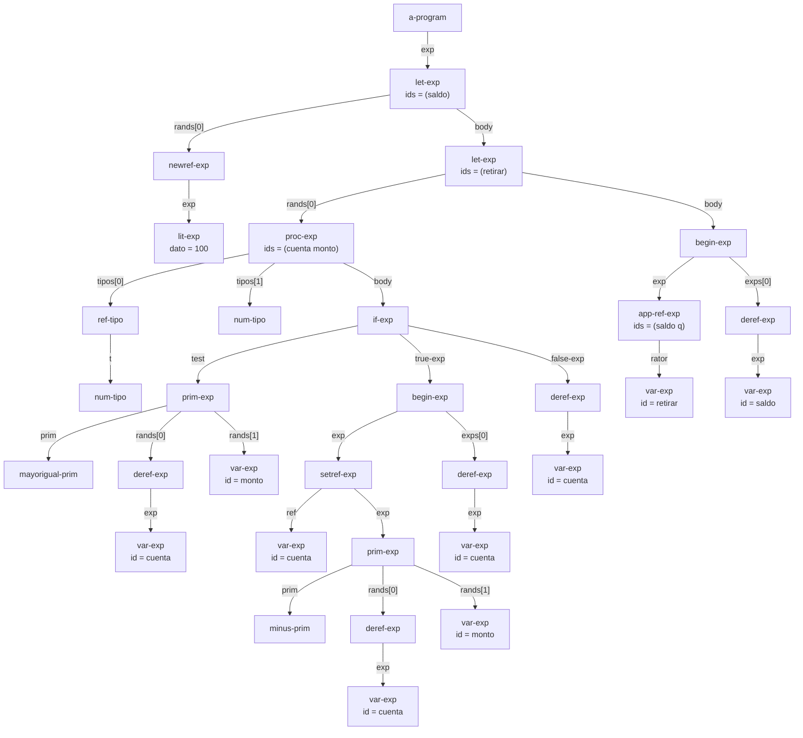
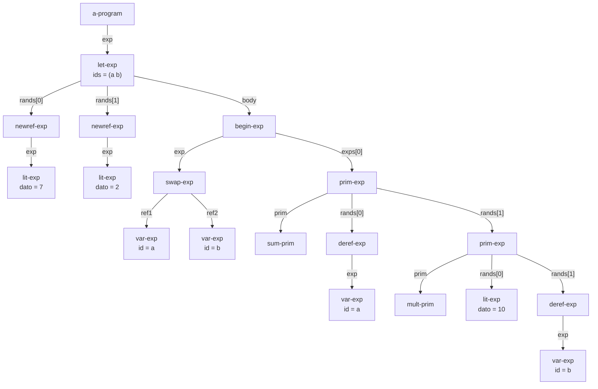
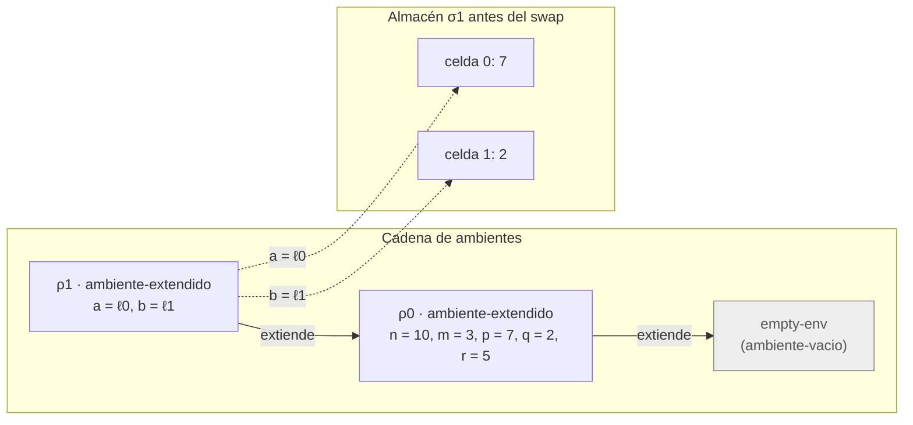
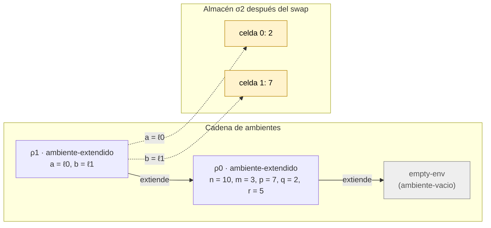

# Informe de AST y traza con almacén — Taller 3: Cauca con referencias y tipos

**Curso:** Fundamentos de Interpretación y Compilación de Lenguajes
de Programación — Universidad del Valle, Sede Tuluá.

**Integrantes del grupo:**

| Nombre                     | Código  | Correo institucional               |
| -------------------------- | ------- | ---------------------------------- |
| Luis David Mendoza Manzano | 2067621 | mendoza.luis@correounivalle.edu.co |

> Los árboles de este informe no están dibujados a mano: salen del
> parser de `src/sintaxis.rkt` aplicado al texto del programa, y los
> resultados y estados del almacén que se citan son la salida real del
> intérprete (`interpretar` y `contenido-almacen`).

---

## 1. Gramática considerada

La gramática de `src/sintaxis.rkt`. Es la del Taller 2 con dos cambios:
seis expresiones nuevas (`newref`, `deref`, `setref`, `swap`, `begin` y
`applyref`) y anotaciones de tipo en los dos ligadores de procedimientos
(`proc` y `letrec`). El intérprete ignora las anotaciones: las lee el
parser, quedan en el árbol y solo las usa el chequeador.

```bnf
<programa>   ::= <expresion>
                 a-program(exp)

<expresion>  ::= <numero>
                 lit-exp(dato)
             ::= <identificador>
                 var-exp(id)
             ::= "true"
                 true-exp()
             ::= "false"
                 false-exp()
             ::= <primitiva> "(" {<expresion>}*(,) ")"
                 prim-exp(prim, rands)
             ::= "if" <expresion> "then" <expresion> "else" <expresion> "end"
                 if-exp(test, true-exp, false-exp)
             ::= "let" {<identificador> "=" <expresion>}* "in" <expresion> "end"
                 let-exp(ids, rands, body)
             ::= "proc" "(" {<identificador> ":" <tipo>}*(,) ")" <expresion> "end"
                 proc-exp(ids, tipos, body)
             ::= "apply" <expresion> "(" {<expresion>}*(,) ")"
                 app-exp(rator, rands)
             ::= "letrec" {<tipo> <identificador>
                           "(" {<identificador> ":" <tipo>}*(,) ")"
                           "=" <expresion>}*
                 "in" <expresion> "end"
                 letrec-exp(tipos-res, proc-names, idss, tipos-args, bodies, body)
             ::= "case" <expresion> {"of" <numero> "=>" <expresion>}*
                 "otherwise" "=>" <expresion> "end"
                 case-exp(control, valores, acciones, default)
             ::= "newref" "(" <expresion> ")"
                 newref-exp(exp)
             ::= "deref" "(" <expresion> ")"
                 deref-exp(exp)
             ::= "setref" "(" <expresion> "," <expresion> ")"
                 setref-exp(ref, exp)
             ::= "swap" "(" <expresion> "," <expresion> ")"
                 swap-exp(ref1, ref2)
             ::= "begin" <expresion> {";" <expresion>}* "end"
                 begin-exp(exp, exps)
             ::= "applyref" <expresion> "(" {<identificador>}*(,) ")"
                 app-ref-exp(rator, ids)

<tipo>       ::= "num"
                 num-tipo()
             ::= "bool"
                 bool-tipo()
             ::= "refto" "(" <tipo> ")"
                 ref-tipo(t)
             ::= "(" {<tipo>}*(*) "->" <tipo> ")"
                 proc-tipo(args, res)

<primitiva>  ::= "+" | "-" | "*" | "/" | "add1" | "sub1" | ">" | ">=" | "<"
               | "<=" | "==" | "not" | "and" | "or" | "abs" | "mcd" | "mcm"
               | "promedio" | "xor" | "implica" | "entre"
                 (un constructor por primitiva: sum-prim, minus-prim, ...)
```

---

## 2. Ejemplos de AST

### Ejemplo 1 — El programa de la Parte 4.1 (retirar de una cuenta)

**Expresión concreta:**

```text
let saldo = newref(100)
in
  let retirar = proc (cuenta : refto(num), monto : num)
                  if >=(deref(cuenta), monto)
                  then begin
                         setref(cuenta, -(deref(cuenta), monto));
                         deref(cuenta)
                       end
                  else deref(cuenta)
                  end
                end
  in
    begin
      applyref retirar (saldo, q);
      deref(saldo)
    end
  end
end
```

**AST** (32 nodos, con los nodos de tipo). Las etiquetas de las aristas
son los nombres de los campos del constructor; `campo[i]` es el elemento
$i$ de un campo que es una lista. Los campos que son listas de
identificadores (`ids`) van dentro de la etiqueta del nodo:



**Explicación.** La raíz `a-program` tiene un único hijo, el `let-exp`
de `saldo`, cuya parte derecha es `newref-exp(lit-exp 100)`. Su cuerpo es
otro `let-exp`, el de `retirar`, cuya parte derecha es un `proc-exp`. Ese
nodo es el que carga los **nodos de tipo**: dos hijos en el campo
`tipos`, `ref-tipo(num-tipo)` para `cuenta` y `num-tipo` para `monto`, en
paralelo con los dos identificadores de su etiqueta. El cuerpo del
procedimiento es un `if-exp`: la condición es una `prim-exp` con
`mayorigual-prim` y dos operandos (`deref-exp` sobre `cuenta`, y
`monto`); la rama `then` es un `begin-exp` con dos expresiones (el
`setref-exp`, cuyo valor nuevo es una resta, y un `deref-exp`); la rama
`else` es un `deref-exp`. El cuerpo del segundo `let-exp` es un
`begin-exp` cuya primera expresión es `app-ref-exp`: el operador es un
`var-exp`, y los argumentos son los identificadores `saldo` y `q`, que
van en la etiqueta del nodo y no como hijos, porque la gramática de
`applyref` exige identificadores y no expresiones.

**Por qué este programa, tal como está escrito, no pasa el chequeador.**
La regla de `applyref` del enunciado es

$$
\frac{\Gamma \vdash f : (t_1 * \cdots * t_n \to t) \qquad \Gamma(x_i) = t_i \qquad t_i = \text{refto}(s_i)}
     {\Gamma \vdash \text{applyref}\ f(x_1,\ldots,x_n) : t}
$$

y exige que **cada** argumento sea una variable de tipo $\text{refto}(s_i)$.
Aquí $f = $ `retirar` tiene tipo $(\text{refto}(\text{num}) * \text{num} \to \text{num})$ y
los argumentos son `saldo` y `q`:

- $\Gamma(\text{saldo}) = \text{refto}(\text{num})$, y coincide con el primer
  parámetro: el primer argumento cumple la regla.
- $\Gamma(\text{q}) = \text{num}$ (viene del ambiente de tipos inicial) y
  $\text{num} \neq \text{refto}(s)$ para todo $s$: el segundo argumento
  **no** cumple $t_2 = \text{refto}(s_2)$. Además el segundo parámetro,
  `monto : num`, tampoco es un `refto`, de modo que `retirar` no se puede
  aplicar por referencia con ningún argumento en esa posición.

El chequeador lo rechaza con

```text
applyref espera refto(t) en el argumento 2, se encontro num
```

y el intérprete, si se ejecutara sin chequear, también fallaría, porque
`q` está ligada al número $2$ y no a una referencia:
`El paso por referencia exige variables ligadas a referencias, y q no lo esta`.

**Corrección mínima.** Cambiar `applyref` por `apply`, es decir, una sola
palabra:

```text
      apply retirar (saldo, q);
```

Con `apply` la regla es la de la aplicación común: el primer argumento
`saldo : refto(num)` coincide con `cuenta : refto(num)` y el segundo
`q : num` coincide con `monto : num`, así que el programa tiene tipo
$\text{num}$ (el de `deref(saldo)`); la prueba "el programa del enunciado,
con la correccion minima" de `pruebas-cauca-refs.rkt` lo comprueba.

Hay que saber qué se pierde: `apply` copia el argumento `saldo` (una
referencia) en una **celda nueva**, de modo que `retirar` escribe en la
copia y `deref(saldo)` sigue dando $100$ al ejecutar el programa
corregido. Si lo que se quiere es que el retiro se vea afuera, hay que
cambiar el diseño y no una palabra: declarar `monto : refto(num)`, leerlo
con `deref(monto)` y pasar una celda en lugar de `q` (por ejemplo
`let q2 = newref(q) in applyref retirar (saldo, q2) ...`); esa versión
tipa y, ejecutada, deja $98$ en `saldo`.

---

### Ejemplo 2 — El programa del `swap` (el que se traza en la sección 3)

**Expresión concreta:**

```text
let a = newref(7)
    b = newref(2)
in
  begin
    swap(a, b);
    +(deref(a), *(10, deref(b)))
  end
end
```

**AST** (19 nodos):



**Explicación.** El `let-exp` tiene dos identificadores (`a`, `b`) y dos
partes derechas, `rands[0]` y `rands[1]`, cada una un `newref-exp` sobre
un `lit-exp`. Su cuerpo es un `begin-exp` con dos expresiones: el
`swap-exp` (campos `ref1` y `ref2`, dos `var-exp`) y una `prim-exp` con
`sum-prim`, cuyo segundo operando es otra `prim-exp` con `mult-prim`.
Este programa no tiene anotaciones de tipo, así que su árbol no tiene
nodos de tipo.

---

## 3. Traza de evaluación con el estado del almacén

Es el segundo ejemplo guía de la Parte 1, el del `swap`: intercambia el
contenido de las celdas, no las referencias.

**Expresión a evaluar:** la del ejemplo 2, que da $72$.

**Ambiente inicial:** $\rho_0 = [\,n = 10,\ m = 3,\ p = 7,\ q = 2,\ r = 5\,]$.
Al empezar el programa el almacén está vacío:
$\sigma_0 = [\,]$ (`initialize-store!`).

**Notación.** $\ell_0$ y $\ell_1$ son las referencias `(a-ref 0)` y
`(a-ref 1)`. El almacén se escribe $\sigma = [\,0 \mapsto v_0,\ 1 \mapsto v_1,\ \ldots\,]$.
Los ambientes y almacenes que se crean son:

- $\rho_1 = [\,a = \ell_0,\ b = \ell_1\,]\rho_0$, el del cuerpo del `let`.
- $\sigma_1 = [\,0 \mapsto 7,\ 1 \mapsto 2\,]$, el almacén después de los dos `newref`.
- $\sigma_2 = [\,0 \mapsto 2,\ 1 \mapsto 7\,]$, el almacén después del `swap`.

**Pasos de la traza** (en el orden en que el intérprete evalúa; la
columna del almacén es el estado **al terminar** esa evaluación, y una
flecha $\to$ marca que la evaluación lo cambió):

| #   | Expresión evaluada             | Ambiente | Estado del almacén               | Valor resultante |
| --- | ------------------------------ | -------- | -------------------------------- | ---------------- |
| 1   | `7`                            | $\rho_0$ | $\sigma_0 = [\,]$                | $7$              |
| 2   | `newref(7)`                    | $\rho_0$ | $[\,] \to [\,0 \mapsto 7\,]$     | $\ell_0$         |
| 3   | `2`                            | $\rho_0$ | $[\,0 \mapsto 7\,]$              | $2$              |
| 4   | `newref(2)`                    | $\rho_0$ | $[\,0 \mapsto 7\,] \to \sigma_1$ | $\ell_1$         |
| 5   | `a`                            | $\rho_1$ | $\sigma_1$                       | $\ell_0$         |
| 6   | `b`                            | $\rho_1$ | $\sigma_1$                       | $\ell_1$         |
| 7   | `swap(a, b)`                   | $\rho_1$ | $\sigma_1 \to \sigma_2$          | $2$              |
| 8   | `deref(a)`                     | $\rho_1$ | $\sigma_2$                       | $2$              |
| 9   | `10`                           | $\rho_1$ | $\sigma_2$                       | $10$             |
| 10  | `deref(b)`                     | $\rho_1$ | $\sigma_2$                       | $7$              |
| 11  | `*(10, deref(b))`              | $\rho_1$ | $\sigma_2$                       | $70$             |
| 12  | `+(deref(a), *(10, deref(b)))` | $\rho_1$ | $\sigma_2$                       | $72$             |
| 13  | `begin swap(a, b); +(...) end` | $\rho_1$ | $\sigma_2$                       | $72$             |
| 14  | el `let` completo              | $\rho_0$ | $\sigma_2$                       | $72$             |

Lo que hace el paso 7, según `swap-exp`: evalúa `a` y `b` (pasos 5 y 6),
verifica que ambas sean referencias, lee los dos contenidos
($c_1 = 7$, $c_2 = 2$), escribe $c_2$ en $\ell_0$ y $c_1$ en $\ell_1$, y
retorna $c_2 = 2$, el contenido anterior de la segunda celda. Los pasos
8 a 12 solo leen: el almacén no cambia. El resultado es
$2 + 10 \cdot 7 = 72$. Nótese que `swap` intercambia el contenido y no
las referencias: después del paso 7, `a` sigue ligada a $\ell_0$ y `b` a
$\ell_1$ (ambiente $\rho_1$ intacto); lo único que cambió es lo que
guardan las celdas.

**Diagrama de la cadena de ambientes y del almacén, antes del `swap`**
(es el estado después del paso 6). Las flechas continuas son las del
ambiente que extiende hacia el ambiente que extendió, hasta el ambiente
vacío; las punteadas son las referencias que `a` y `b` guardan:



**Diagrama después del `swap`** (es el estado después del paso 7).
Las referencias son las mismas, `a` sigue señalando la celda 0 y `b` la
celda 1; lo que cambió es el contenido de las dos celdas (resaltadas):



---

## 4. Estado del almacén en una transacción

No aplica: el lenguaje de este taller no tiene bloques transaccionales
(`atomic`). Las dos instantáneas del almacén que pide la Parte 4.2, antes
y después del `swap`, están en la sección 3.

---

## 5. Referencias

- Friedman, D. P., & Wand, M. _Essentials of Programming Languages_,
  3.ª ed., MIT Press, 2008. Sección 2.5 (sintaxis abstracta con
  `define-datatype`), secciones 3.2 y 3.4 (ambientes), sección 4.2
  (EXPLICIT-REFS, almacén y referencias) y sección 7.2 (CHECKED, tipos
  anotados).
- Notas de clase: Clases 5 y 6 (procedimientos y `letrec`).
