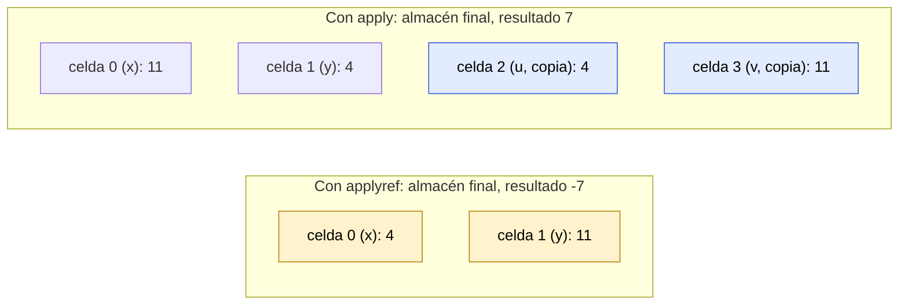

# Informe de corrección — Taller 3: Cauca con referencias y tipos

**Curso:** Fundamentos de Interpretación y Compilación de Lenguajes
de Programación — Universidad del Valle, Sede Tuluá.

**Integrantes del grupo:**

| Nombre                     | Código  | Correo institucional               |
| -------------------------- | ------- | ---------------------------------- |
| Luis David Mendoza Manzano | 2067621 | mendoza.luis@correounivalle.edu.co |

> Los fragmentos de código de este informe están copiados de `src/` tal
> como se entregan. Los resultados y los mensajes de error que se citan
> son la salida real del intérprete y del chequeador (se comprueban en
> `pruebas-cauca-refs.rkt`).

---

## 1. Marco formal

### 1.1 Corrección de programas recursivos

Sea $f : A \to B$ una función y $A$ un conjunto definido
recursivamente. Sea $P_f$ un programa recursivo en Racket que
pretende calcular $f$. Decimos que $P_f$ es correcto con respecto a
su especificación si se cumple:

$$
\forall a \in A \,:\, P_f(a) = f(a)
$$

La estrategia de demostración es la **inducción estructural**
sobre $A$:

- **Caso base:** para cada valor básico $a_0 \in A$ se verifica
  $P_f(a_0) = f(a_0)$.
- **Caso inductivo:** asumiendo la **hipótesis de inducción**
  $P_f(a') = f(a')$ para las subestructuras $a'$ que forman $a$, se
  demuestra $P_f(a) = f(a)$.

Cuando la estructura sobre la que se induce no es una lista sino la
**derivación de un juicio de tipos** (sección 2.3), la inducción es sobre
la derivación: el caso base son las reglas sin premisas y el caso
inductivo cada regla con premisas, con la hipótesis de inducción sobre
las derivaciones de las premisas.

### 1.2 Corrección de programas iterativos

Las funciones analizadas en este taller no son iterativas con
acumulador: `lista-con-valor` y `append` recorren una lista por
recursión estructural, y `swap-exp` es una secuencia finita de pasos sin
ciclos. Por eso basta el esquema de la sección 1.1 y una medida
decreciente para la terminación. La invariante que sí se enuncia, la del
almacén, no es la de un acumulador sino una propiedad que debe sostenerse
en el estado global entre operaciones: se plantea en la sección 2.1 con
el mismo esquema (se cumple al empezar y cada operación la preserva).

### 1.3 Notación del almacén

Un almacén es una secuencia finita de celdas
$\sigma = (c_0, \ldots, c_{n-1})$, con $|\sigma| = n$ y
$\sigma(i) = c_i$ para $0 \le i < n$. En el código es la lista
`the-store`. Una referencia $\ell = \texttt{(a-ref } i\texttt{)}$ tiene
posición $\text{pos}(\ell) = i$; es **válida en** $\sigma$ si
$0 \le \text{pos}(\ell) < |\sigma|$, y entonces
$\sigma(\ell) = \sigma(\text{pos}(\ell))$. $R$ es el conjunto de las
referencias que `newref!` ha entregado desde el último `initialize-store!`.
$\sigma \cdot v$ es $\sigma$ con $v$ agregado al final (en el código,
`(append the-store (list val))`).

---

## 2. Funciones analizadas

### 2.1 El almacén preserva su invariante (`newref!`, `setref!`, `deref`)

**Especificación.**

- **Tipos:**
  `newref! : valor -> referencia`,
  `setref! : referencia x valor -> void`,
  `deref : referencia -> valor`.
- **Invariante.** El enunciado pide cuatro condiciones. La primera es una
  propiedad del **estado** $(\sigma, R)$; las otras tres son propiedades
  de lo que cada **operación** le hace al almacén. Se enuncian juntas como
  $\text{Inv}$:

$$
\begin{aligned}
\text{(I1)}\ & \forall \ell \in R:\ \ell \text{ es válida en } \sigma
  && \text{(toda referencia entregada apunta a una celda existente)}\\
\text{(I2)}\ & \text{newref!}:\ |\sigma'| = |\sigma| + 1
  \quad;\quad \text{setref!},\ \text{deref}:\ |\sigma'| = |\sigma|
  && \text{(el almacén solo crece por newref!)}\\
\text{(I3)}\ & \sigma' = \text{setref!}(\sigma, \ell, v)\ \Rightarrow\
  \sigma'(\ell) = v \ \land\ \forall \ell' \neq \ell\ \text{válida}:\ \sigma'(\ell') = \sigma(\ell')
  && \text{(setref! cambia exactamente una celda)}\\
\text{(I4)}\ & \ell \text{ no válida en } \sigma\ \Rightarrow\ \text{deref}(\sigma, \ell) = \mathsf{err}
  && \text{(deref fuera de rango levanta eopl:error)}
\end{aligned}
$$

- **Estado inicial.** `initialize-store!` deja $\sigma = ()$ y $R = \varnothing$.
  Con $R$ vacío, (I1) se cumple trivialmente.
- **Contratos de las tres operaciones** (lo que hay que demostrar):
  1. `newref!` agrega **exactamente una** celda, retorna una referencia
     válida y no altera las celdas existentes:
     $\sigma' = \sigma \cdot v$, $\ \sigma'(i) = \sigma(i)$ para
     $i < |\sigma|$, $\ \sigma'(|\sigma|) = v$ y retorna
     $\ell = \texttt{(a-ref } |\sigma| \texttt{)}$.
  2. `setref!` cumple (I3) y deja $|\sigma'| = |\sigma|$.
  3. `deref` no modifica el almacén: $\sigma' = \sigma$, y retorna $\sigma(\ell)$.

**Código.**

```racket
;; newref! : valor -> referencia
;; Agrega una celda con el valor al final del almacén y retorna la
;; referencia que la nombra. No toca las celdas que ya existían.
;; Ejemplo: sobre un almacén vacío, (newref! 7) => (a-ref 0)
(define newref!
  (lambda (val)
    (let ((pos (length the-store)))
      (begin
        (set! the-store (append the-store (list val)))
        (a-ref pos)))))
```

```racket
;; deref : referencia -> valor
;; Lee la celda que nombra la referencia. No modifica el almacén. Si la
;; posición está fuera de rango levanta eopl:error.
;; Ejemplo: tras (newref! 7), (deref (a-ref 0)) => 7
(define deref
  (lambda (ref)
    (cases referencia ref
      (a-ref (pos)
        (if (posicion-valida? pos)
            (list-ref the-store pos)
            (eopl:error 'deref "Referencia fuera de rango: ~s" pos))))))
```

```racket
;; setref! : referencia x valor -> void
;; Escribe el valor en la celda que nombra la referencia y deja las demás
;; intactas; el almacén no cambia de tamaño. Si la posición está fuera de
;; rango levanta eopl:error.
;; Ejemplo: tras (newref! 7), (setref! (a-ref 0) 9) deja el almacén en (9)
(define setref!
  (lambda (ref val)
    (cases referencia ref
      (a-ref (pos)
        (if (posicion-valida? pos)
            (set! the-store (lista-con-valor the-store pos val))
            (eopl:error 'setref! "Referencia fuera de rango: ~s" pos))))))
```

```racket
;; lista-con-valor : lista x int x valor -> lista
;; La misma lista con el elemento de la posición pos reemplazado por val.
;; Las demás posiciones conservan su valor. Requiere 0 <= pos < largo.
;; Ejemplo: (lista-con-valor '(a b c) 1 'x) => (a x c)
(define lista-con-valor
  (lambda (lst pos val)
    (if (= pos 0)
        (cons val (cdr lst))
        (cons (car lst) (lista-con-valor (cdr lst) (- pos 1) val)))))
```

```racket
;; posicion-valida? : int -> boolean
;; #t si la posición nombra una celda existente del almacén.
(define posicion-valida?
  (lambda (pos)
    (and (>= pos 0) (< pos (length the-store)))))
```

**Demostración.**

_Lema A (agregar al final)._ Para toda lista $\sigma$ y todo $v$:
$(\sigma \cdot v)(i) = \sigma(i)$ si $i < |\sigma|$, y
$(\sigma \cdot v)(|\sigma|) = v$. Se demuestra por inducción estructural
sobre $\sigma$.

- **Caso base** ($\sigma = ()$): $\sigma \cdot v = (v)$, y
  $(\sigma \cdot v)(0) = v = (\sigma \cdot v)(|\sigma|)$. No hay índices
  $i < 0$ que verificar.
- **Caso inductivo** ($\sigma = c :: \sigma_0$): `append` da
  $\sigma \cdot v = c :: (\sigma_0 \cdot v)$. El índice $0$ da
  $c = \sigma(0)$. Para el índice $i + 1$ con $i + 1 < |\sigma|$, es
  $(\sigma_0 \cdot v)(i)$, que por hipótesis de inducción es
  $\sigma_0(i) = \sigma(i + 1)$. Y el índice $|\sigma| = |\sigma_0| + 1$
  es $(\sigma_0 \cdot v)(|\sigma_0|)$, que por hipótesis de inducción es
  $v$. $\square$

_Lema B (reemplazar una posición)._ Si $0 \le i < |\sigma|$ y
$\sigma' = $ `(lista-con-valor σ i v)`, entonces $|\sigma'| = |\sigma|$,
$\sigma'(i) = v$ y $\sigma'(j) = \sigma(j)$ para todo $j \neq i$. Se
demuestra por inducción sobre $i$.

- **Caso base** ($i = 0$): como $0 < |\sigma|$, $\sigma = c :: \sigma_0$ y
  `lista-con-valor` da $\sigma' = v :: \sigma_0$. Entonces
  $\sigma'(0) = v$ y para $j \geq 1$, $\sigma'(j) = \sigma_0(j - 1) = \sigma(j)$.
  La longitud no cambia.
- **Caso inductivo** ($i > 0$): $\sigma = c :: \sigma_0$ y
  $\sigma' = c :: \sigma_0'$ con $\sigma_0' = $ `(lista-con-valor σ0 (i-1) v)`.
  Como $0 \le i - 1 < |\sigma_0|$, la hipótesis de inducción dice que
  $|\sigma_0'| = |\sigma_0|$, $\sigma_0'(i-1) = v$ y
  $\sigma_0'(k) = \sigma_0(k)$ para $k \neq i - 1$. Entonces
  $\sigma'(0) = c = \sigma(0)$ (y $0 \neq i$); $\sigma'(i) = \sigma_0'(i-1) = v$;
  y para $j \geq 1$, $j \neq i$: $\sigma'(j) = \sigma_0'(j-1) = \sigma_0(j-1) = \sigma(j)$.
- **Terminación.** La medida es $i \in \mathbb{N}$: cada llamada recursiva
  usa $i - 1$ y el caso $i = 0$ no llama. $\square$

_(1) `newref!` preserva el invariante._ La función toma
$n = |\sigma|$, asigna $\sigma' = \sigma \cdot v$ con `set!` y retorna
`(a-ref n)`.

- Longitud: $|\sigma'| = n + 1$ (I2).
- Celdas: por el Lema A, $\sigma'(i) = \sigma(i)$ para $i < n$ y
  $\sigma'(n) = v$: agrega **exactamente una** celda y no altera las
  existentes.
- Referencia: $\text{pos}(\ell) = n < n + 1 = |\sigma'|$, y $n \geq 0$:
  $\ell$ es válida en $\sigma'$. Las referencias de $R$ eran válidas en
  $\sigma$ (hipótesis (I1)), es decir tenían posición $< n < n + 1$: siguen
  siendo válidas. Con $R' = R \cup \{\ell\}$, (I1) se cumple en
  $(\sigma', R')$. $\square$

_(2) `setref!` preserva el invariante, con la condición sobre las celdas
no tocadas._ Sea $\ell = \texttt{(a-ref } i\texttt{)}$.

- **Si $\ell$ es válida en $\sigma$** (`posicion-valida?` da $\#t$):
  $\sigma' = $ `(lista-con-valor σ i v)`. Por el Lema B,
  $|\sigma'| = |\sigma|$ (I2), $\sigma'(\ell) = v$ y $\sigma'(\ell') = \sigma(\ell')$
  para todo $\ell' \neq \ell$ (I3): **exactamente** una celda cambia y las
  demás conservan su valor. Como la longitud no cambió, toda referencia
  de $R$ sigue siendo válida: (I1).
- **Si $\ell$ no es válida:** `setref!` levanta `eopl:error` _antes_ de
  ejecutar `set!`, de modo que $\sigma$ queda intacto y la ejecución
  termina en error: el invariante no se rompe. $\square$

_(3) `deref` preserva el invariante y no modifica el almacén._ El cuerpo
de `deref` no contiene ningún `set!`: solo evalúa `posicion-valida?` y
`list-ref` sobre `the-store`. Por tanto $\sigma' = \sigma$ y $R' = R$, y
(I1) e (I2) se cumplen. Si $\ell$ es válida retorna $\sigma(\ell)$; si no
lo es, levanta `eopl:error`: eso es (I4). $\square$

_(4) El invariante vale en toda ejecución._ El único código que asigna
`the-store` está en `initialize-store!`, `newref!` y `setref!`, y el
evaluador solo toca el almacén llamando a estas operaciones (y a `deref`,
que no lo modifica). `initialize-store!` establece $\text{Inv}$ (estado
inicial) y por (1), (2) y (3) cada operación lo preserva. Por inducción
sobre el número de operaciones ejecutadas, $\text{Inv}$ se cumple después
de cada una, en cualquier programa. Además, un programa de Cauca no puede
construir una referencia por su cuenta: la gramática no tiene sintaxis
para `a-ref`, y las referencias que circulan son solo las que entregó
`newref!` (también `copia-por-valor`, que llama a `newref!`); por eso el
conjunto $R$ contiene todas las referencias que pueden aparecer. Y si el
programa pasa un valor que no es una referencia a `deref`, `setref` o
`swap`, el evaluador lo detecta con `referencia?` y levanta error antes de
tocar el almacén. $\blacksquare$

---

### 2.2 Corrección de `swap-exp`

**Especificación.**

- **Tipo:** la cláusula `swap-exp` de `evaluar-expresion`:
  `expresion x expresion x ambiente -> valor`.
- **Pre-condición:** las dos expresiones se evalúan, en ese orden, a las
  referencias $\ell_1$ y $\ell_2$, ambas válidas en $\sigma$.
- **Post-condición.** Sea $\sigma$ el almacén antes y $\sigma'$ después de
  $\text{swap}(\ell_1, \ell_2)$, y $r$ el valor retornado:

$$
\sigma'(\ell_1) = \sigma(\ell_2),\qquad
\sigma'(\ell_2) = \sigma(\ell_1),\qquad
\sigma'(\ell) = \sigma(\ell)\ \ \text{para toda otra celda } \ell,
\qquad r = \sigma(\ell_2).
$$

Si alguno de los dos valores no es una referencia, o no es válida,
levanta `eopl:error` **sin haber escrito nada**.

**Código.**

```racket
(swap-exp (ref1-exp ref2-exp)
  (let* ((ref1 (evaluar-expresion ref1-exp env))
         (ref2 (evaluar-expresion ref2-exp env)))
    (if (and (referencia? ref1) (referencia? ref2))
        (let ((contenido1 (deref ref1))
              (contenido2 (deref ref2)))
          (begin (setref! ref1 contenido2)
                 (setref! ref2 contenido1)
                 contenido2))
        (eopl:error 'swap-exp
                    "swap exige dos referencias y llegaron ~s y ~s"
                    ref1 ref2))))
```

**Demostración.** Sean $c_1 = \sigma(\ell_1)$ y $c_2 = \sigma(\ell_2)$.

_Lecturas antes de escrituras._ El `let` liga `contenido1` y
`contenido2` con dos llamadas a `deref`, y `deref` no modifica el
almacén (sección 2.1, punto 3). Por tanto, cuando se ejecutan las dos
`setref!` ya se tiene $c_1 = \sigma(\ell_1)$ y $c_2 = \sigma(\ell_2)$ con
los valores **originales**. Es lo que impide perder el valor de la
primera celda: una versión que leyera la primera celda _después_ de
escribirla (`setref!(ℓ1, deref ℓ2); setref!(ℓ2, deref ℓ1)`) dejaría
ambas celdas con $c_2$ y $c_1$ se perdería.

Las dos escrituras son: $\sigma_1 = \text{setref!}(\sigma, \ell_1, c_2)$ y
$\sigma_2 = \text{setref!}(\sigma_1, \ell_2, c_1)$, y $\sigma' = \sigma_2$.
Por (I3) de la sección 2.1:

- $\sigma_1(\ell_1) = c_2$ y $\sigma_1(\ell) = \sigma(\ell)$ para
  $\ell \neq \ell_1$.
- $\sigma_2(\ell_2) = c_1$ y $\sigma_2(\ell) = \sigma_1(\ell)$ para
  $\ell \neq \ell_2$.

**Caso $\ell_1 \neq \ell_2$.**

- $\sigma'(\ell_2) = c_1 = \sigma(\ell_1)$. ✓
- $\sigma'(\ell_1) = \sigma_2(\ell_1) = \sigma_1(\ell_1)$ (porque
  $\ell_1 \neq \ell_2$) $= c_2 = \sigma(\ell_2)$. ✓
- Para $\ell \notin \{\ell_1, \ell_2\}$:
  $\sigma'(\ell) = \sigma_2(\ell) = \sigma_1(\ell) = \sigma(\ell)$. ✓

El valor original de la primera celda no se pierde: está en
`contenido1`, que se escribe en $\ell_2$, y $\sigma'(\ell_2) = c_1$.

**Caso $\ell_1 = \ell_2 = \ell$** (el intercambio de una referencia
consigo misma). La especificación exige entonces
$\sigma'(\ell) = \sigma(\ell)$ (las dos primeras ecuaciones se reducen a
la misma) y que las demás celdas queden igual: _la celda no cambia_. La
implementación lo cumple: $c_1 = c_2 = \sigma(\ell) =: c$, la primera
escritura deja $\sigma_1(\ell) = c$ y la segunda también
$\sigma_2(\ell) = c$; las demás celdas no se tocan por (I3). Entonces
$\sigma' = \sigma$ y la post-condición vale, sin ningún caso especial en
el código. (La prueba `swap de una referencia consigo misma deja la
celda igual` lo comprueba: `let c = newref(4) in begin swap(c, c); deref(c) end end` da $4$.)

**Valor retornado.** La cláusula retorna `contenido2`, que es
$c_2 = \sigma(\ell_2)$ evaluado **antes** de cualquier escritura: el
contenido anterior de la segunda celda. Por eso, con $\ell_1 = $ la celda
de `7` y $\ell_2 = $ la de `2`, `swap(a, b)` da $2$, y no $7$, que es lo que
quedó en $\ell_2$. Si $\ell_1 = \ell_2$ retorna $\sigma(\ell)$, también
$\sigma(\ell_2)$. ✓

**Los errores no escriben.** Si `ref1` o `ref2` no es una referencia, el
`if` toma la rama de error sin ejecutar ningún `deref` ni `setref!`. Si
son referencias pero alguna no es válida, el error sale del `deref` del
`let`, que se ejecuta antes que cualquiera de las dos `setref!`. En los
dos casos $\sigma' = \sigma$: `swap` o termina completo o falla sin dejar
el almacén a medias.

**Invariante.** `swap` solo usa `deref` y `setref!` sobre referencias
válidas, así que por la sección 2.1 preserva $\text{Inv}$ y no cambia la
longitud del almacén. **Terminación:** son cuatro llamadas a funciones
que terminan (sección 2.1), sin ciclos.

**Conclusión:** `swap-exp` satisface la post-condición, incluido el caso
$\ell_1 = \ell_2$, y retorna el contenido anterior de la segunda celda.
$\blacksquare$

---

### 2.3 Solidez del chequeador

**Enunciado (fragmento de Cauca sin referencias).**

$$
\text{Si } \Gamma \vdash e : t \ \text{ y } \ \rho \sim \Gamma, \ \text{ entonces }\ \text{value-of}(e, \rho) \text{ es un valor de tipo } t.
$$

Como `letrec` permite programas que no terminan, la solidez es de
corrección parcial: el enunciado se lee «_si_ la evaluación termina, su
valor es de tipo $t$ y no levanta ninguno de los errores que el
chequeador existe para prevenir» (condición del `if` no booleana,
aplicar algo que no es un procedimiento, aridad incorrecta, variable no
ligada).

**Qué significa «un valor de tipo $t$» y «$\rho$ concuerda con $\Gamma$».**
La relación $v : t$ se define por recursión sobre la estructura del tipo
$t$:

$$
\begin{aligned}
v : \text{num} \ &\iff\ v \text{ es un número}\\
v : \text{bool} \ &\iff\ v \text{ es un booleano}\\
v : (t_1 * \cdots * t_n \to t) \ &\iff\ v = \texttt{cerradura}(\vec{x}, B, \rho') \text{ con } |\vec{x}| = n \text{ y, para todos } a_1,\ldots,a_n\\
& \hphantom{\iff\ } \text{con } a_i : t_i,\ \text{value-of}(B,\ [\,\vec{x} = \vec{a}\,]\rho') \text{ es un valor de tipo } t
\end{aligned}
$$

La definición de la flecha usa solamente tipos más pequeños ($t_i$ y
$t$), así que es una definición por recursión estructural y está bien
fundada. Un ambiente de valores $\rho$ **concuerda** con un ambiente de
tipos $\Gamma$, y se escribe $\rho \sim \Gamma$, cuando toda variable
declarada en $\Gamma$ está ligada en $\rho$ a un valor de ese tipo:

$$
\rho \sim \Gamma \iff \forall x \ \text{declarada en } \Gamma:\ \ \rho(x)\ \text{está definido y}\ \ \rho(x) : \Gamma(x)
$$

donde $\rho(x) = \text{lookup}(\rho, x)$ y $\Gamma(x)$ es `apply-tenv`.
El ambiente inicial cumple $\rho_0 \sim \Gamma_0$: las cinco variables
son números y `tenv-inicial` las declara `num`.

_Lema E (extender)._ Si $\rho \sim \Gamma$ y $a_i : t_i$, entonces
$[\,\vec{x} = \vec{a}\,]\rho \sim [\,\vec{x} : \vec{t}\,]\Gamma$.
_Demostración._ `apply-env` y `apply-tenv` buscan con la misma regla: la
primera coincidencia del eslabón más reciente, y si el nombre no está,
siguen por el ambiente que extienden. Para $y \in \vec{x}$ los dos
devuelven la entrada del mismo índice, que cumple $a_i : t_i$. Para
$y \notin \vec{x}$ los dos siguen por $\rho$ y $\Gamma$, donde vale la
hipótesis. $\square$

**Demostración.** Por inducción sobre la derivación de $\Gamma \vdash e : t$,
para todo $\rho$ con $\rho \sim \Gamma$ (la hipótesis de inducción se usa
con ambientes distintos del de la conclusión; por eso se cuantifica
sobre todo $\rho$). Casos:

**Caso `if`.** La derivación termina con la regla

$$
\frac{\Gamma \vdash e_1 : \text{bool} \quad \Gamma \vdash e_2 : t \quad \Gamma \vdash e_3 : t}
     {\Gamma \vdash \text{if } e_1 \text{ then } e_2 \text{ else } e_3 \text{ end} : t}
$$

El código de la cláusula es:

```racket
(if-exp (test true-exp false-exp)
  (let ((test-value (evaluar-expresion test env)))
    (if (boolean? test-value)
        (if test-value
            (evaluar-expresion true-exp env)
            (evaluar-expresion false-exp env))
        (eopl:error 'if-exp
                    "La condicion debe ser booleana y llego ~s"
                    test-value))))
```

Por hipótesis de inducción sobre la premisa $\Gamma \vdash e_1 : \text{bool}$,
`test-value` $= \text{value-of}(e_1, \rho)$ es un valor de tipo $\text{bool}$,
es decir un booleano. Entonces `(boolean? test-value)` es verdadero y **no
se toma la rama de error** «La condicion debe ser booleana». Hay dos
casos:

- `test-value` $= \#t$: el resultado es $\text{value-of}(e_2, \rho)$, que por
  hipótesis de inducción sobre $\Gamma \vdash e_2 : t$ es un valor de tipo $t$.
- `test-value` $= \#f$: el resultado es $\text{value-of}(e_3, \rho)$, de tipo
  $t$ por hipótesis de inducción sobre $\Gamma \vdash e_3 : t$.

En los dos casos el valor es de tipo $t$. **Por eso la regla exige que las
dos ramas tengan el mismo tipo $t$:** el chequeador no sabe cuál de las dos
se va a ejecutar, y si fueran $t_2 \neq t_3$ no habría un único $t$ que
valiera para el resultado de cualquier ejecución (el programa `if >(n, m)
then 1 else false end` corre y da $1$, pero el mismo `if` con `n` y `m`
al revés da `false`; por eso el chequeador lo rechaza con «Las ramas del
if deben coincidir: num vs bool»). $\square$

**Caso `apply`.** La derivación termina con la regla

$$
\frac{\Gamma \vdash f : (t_1 * \cdots * t_n \to t) \qquad \Gamma \vdash e_i : t_i \ \ (1 \le i \le n)}
     {\Gamma \vdash \text{apply } f(e_1, \ldots, e_n) : t}
$$

El código de la cláusula y el de `apply-procedure` son:

```racket
(app-exp (rator rands)
  (let ((proc (evaluar-expresion rator env)))
    (if (procval? proc)
        (apply-procedure proc (copiar-lista (evaluar-rands rands env)))
        (eopl:error 'app-exp
                    "Se intento aplicar algo que no es un procedimiento: ~s"
                    proc))))
```

```racket
;; apply-procedure : procval x lista de valores -> valor
;; Verifica la aridad y evalúa el cuerpo en el ambiente de la clausura
;; extendido con los parámetros. No copia nada: lo que llegue en args es
;; lo que queda ligado (apply copia antes de llamar; applyref no).
;; Ejemplo: aplicar la clausura de proc (x : num) add1(x) end a (4) => 5
(define apply-procedure
  (lambda (proc args)
    (cases procval proc
      (cerradura (ids body env)
        (if (= (length ids) (length args))
            (evaluar-expresion body (ambiente-extendido ids args env))
            (eopl:error 'apply-procedure
                        "El procedimiento espera ~s argumentos y recibio ~s"
                        (length ids) (length args)))))))
```

1. Por hipótesis de inducción sobre la premisa de $f$,
   $v_f = \text{value-of}(f, \rho)$ es un valor de tipo
   $(t_1 * \cdots * t_n \to t)$. Por la definición de $v : (\ldots \to t)$,
   $v_f = \texttt{cerradura}(\vec{x}, B, \rho')$ con $|\vec{x}| = n$. En
   particular `(procval? proc)` es verdadero y **no se toma el error**
   «Se intento aplicar algo que no es un procedimiento».
2. Por hipótesis de inducción sobre cada premisa $\Gamma \vdash e_i : t_i$,
   el valor $a_i = \text{value-of}(e_i, \rho)$ es de tipo $t_i$ (los
   operandos se evalúan en el mismo $\rho$, de izquierda a derecha). En el
   fragmento sin referencias `copia-por-valor` es la identidad sobre
   números, booleanos y procedimientos, de modo que los valores que llegan
   a `apply-procedure` siguen siendo $a_i : t_i$.
3. `apply-procedure` compara `(length ids)` $= n$ con `(length args)` $=
   n$: son iguales, y **no se toma el error** de aridad.
4. El resultado es $\text{value-of}(B, [\,\vec{x} = \vec{a}\,]\rho')$.
   Como $v_f : (t_1 * \cdots * t_n \to t)$ y $a_i : t_i$, la definición de
   la relación $v : (\ldots \to t)$ afirma exactamente que este valor es de
   tipo $t$. ✓ $\square$

_Observación._ La definición de «$v : (\ldots \to t)$» es lo que hace
que la regla de `proc` también se demuestre: la derivación de
$\Gamma \vdash \text{proc}(\vec{x} : \vec{t})\,B\ \text{end} : (\vec{t} \to r)$
tiene la premisa $[\,\vec{x} : \vec{t}\,]\Gamma \vdash B : r$; el valor
$\texttt{cerradura}(\vec{x}, B, \rho)$ es de tipo $(\vec{t} \to r)$
porque, para toda lista $\vec{a}$ con $a_i : t_i$,
$[\,\vec{x} = \vec{a}\,]\rho \sim [\,\vec{x} : \vec{t}\,]\Gamma$ (Lema E) y
la hipótesis de inducción da que $\text{value-of}(B, [\,\vec{x} = \vec{a}\,]\rho)$
es de tipo $r$. Los demás casos (literal, variable, primitivas, `let`,
`case`) son análogos; `letrec` exige además una inducción sobre el número
de llamadas, porque la cerradura se refiere a sí misma.

**Qué se rompe cuando se agregan las referencias.** Con `newref`,
`deref`, `setref`, `swap` y `begin` el enunciado anterior deja de ser
suficiente, por tres razones.

1. **La evaluación ya no es una función de $(e, \rho)$.** `value-of`
   depende de un almacén $\sigma$ y además lo modifica: el resultado es un
   par $(v, \sigma')$. Evaluar dos veces la misma expresión en el mismo
   ambiente puede dar valores distintos: el cuerpo
   `begin setref(c, add1(deref(c))); deref(c) end`, evaluado dos veces
   seguidas con el mismo $\rho$ (con `c` ligada a $\ell_0$), da $1$ y
   luego $2$.
2. **Una referencia no tiene tipo por sí misma.** El valor
   $\texttt{(a-ref 0)}$ es el mismo objeto en `refto(num)` y en
   `refto(bool)`: su tipo depende de **lo que contiene la celda 0**, y eso
   está en $\sigma$, no en $\rho$. El ambiente de valores solo liga `c` a
   $\ell_0$; qué hay en $\ell_0$ lo dice el almacén. Por eso la relación
   $v : \text{refto}(t)$ tiene que hablar del almacén.
3. **El almacén cambia durante la evaluación**, así que hay que garantizar
   que cambie sin romper los tipos que ya se prometieron.

El enunciado correcto introduce un **tipado del almacén**
$\Sigma$, que asigna un tipo a cada posición, y una concordancia
$\sigma \sim \Sigma$ ($\forall i < |\sigma|:\ \sigma(i) : \Sigma(i)$ ), y
define $v : \text{refto}(t) \iff v = \texttt{(a-ref } i\texttt{)} \land \Sigma(i) = t$.
La solidez se enuncia entonces así:

$$
\Gamma \vdash e : t,\ \ \rho \sim \Gamma,\ \ \sigma \sim \Sigma
\ \Longrightarrow\
\text{value-of}(e, \rho, \sigma) = (v, \sigma') \ \text{ con } \ \exists\, \Sigma' \supseteq \Sigma:\ \ v : t \ \text{ y }\ \sigma' \sim \Sigma'.
$$

El $\Sigma' \supseteq \Sigma$ refleja que el almacén solo crece (I2): `newref!`
agrega una posición con el tipo de su contenido, y ninguna operación cambia
el tipo de una posición que ya existe. Las reglas que mantienen
$\sigma' \sim \Sigma'$ son justamente las de `setref` y `swap`: exigen que
lo escrito tenga **el tipo que la celda ya prometía**. Si la regla de
`setref` permitiera otro tipo, el programa

```text
let c = newref(0) in begin setref(c, true); +(deref(c), 1) end end
```

tendría tipo $\text{num}$ (porque `deref(c) : num` según la promesa de la
celda) pero fallaría al ejecutarse con `Se esperaba un numero y llego #t`.
El chequeador lo rechaza antes: «La celda guarda num y se intento escribir
bool». Lo mismo vale para `applyref` (el parámetro y la celda deben tener
el mismo `refto(s)`, así que el procedimiento solo escribe valores de tipo
$s$) y para el paso por valor: `copia-por-valor` agrega una celda con el
mismo contenido, es decir una posición nueva de tipo $s$, así que
$\Sigma' = \Sigma[\,\text{nueva} \mapsto s\,]$ y $\sigma' \sim \Sigma'$.
Finalmente, la definición de «$v : (\vec{t} \to t)$» también debe
cuantificar sobre los almacenes en que se llama el procedimiento, porque
su cuerpo puede leer y escribir celdas. $\blacksquare$

---

## 3. Propiedades adicionales

### 3.1 Paso por referencia frente a paso por valor

**Enunciado.** Sea $\vec{x}$ la lista de identificadores de la aplicación,
ligados en $\rho$ a las referencias $\ell_1, \ldots, \ell_n$, y $\vec{u}$ los
parámetros del procedimiento.

- Con `applyref`, el parámetro $u_i$ queda ligado a $\ell_i$, **la misma**
  referencia: toda escritura en $\ell_i$ hecha dentro del procedimiento
  se observa afuera.
- Con `apply`, el parámetro $u_i$ queda ligado a una referencia **nueva**
  $\ell_i' \neq \ell_i$ cuya celda contiene lo mismo que la de $\ell_i$:
  $\sigma'(\ell_i') = \sigma(\ell_i)$ al empezar. Una escritura en $\ell_i'$
  no se observa afuera.

**Demostración.** En `applyref`, `evaluar-ids` devuelve las mismas
referencias que `apply-env` encuentra en $\rho$, y `apply-procedure` las
liga a los parámetros sin tocarlas: $\rho'(u_i) = \ell_i$. Cualquier
`setref!` o `swap` sobre $u_i$ es una escritura sobre la celda $\ell_i$,
y la lectura posterior `deref` por $x_i$ la ve. En `apply`,
`copia-por-valor` llama a `(newref! (deref val))`: por el contrato de
`newref!` (sección 2.1) la referencia retornada tiene posición $|\sigma|$,
que no pertenece a ninguna referencia entregada antes, así que
$\ell_i' \neq \ell_i$, y su celda contiene $\sigma(\ell_i)$. Una escritura
sobre $\ell_i'$ cambia solo esa celda (I3): $\sigma'(\ell_i) = \sigma(\ell_i)$
para $\ell_i \neq \ell_i'$. $\square$

El código de la copia:

```racket
;; copia-por-valor : valor -> valor
;; El paso por valor entrega una copia del argumento. Para un número, un
;; booleano o un procedimiento la copia es el mismo valor; para una
;; referencia es una celda nueva con el mismo contenido. applyref no usa
;; esta función: ahí el parámetro queda ligado a la misma celda.
;; Ejemplo: (copia-por-valor 5) => 5
;;          sobre un almacén vacío, (copia-por-valor (newref! 7)) => (a-ref 1),
;;          y la celda 1 contiene 7
(define copia-por-valor
  (lambda (val)
    (if (referencia? val)
        (newref! (deref val))
        val)))
```

Para un número, un booleano o un procedimiento la copia es el mismo
valor y no hay nada observable; solo una referencia se copia a una celda
nueva.

**El programa que separa los dos mecanismos** (el de la Parte 2):

```text
let x = newref(11)
    y = newref(4)
in
  let intercambiar = proc (u : refto(num), v : refto(num))
                       swap(u, v)
                     end
  in
    begin
      applyref intercambiar (x, y);
      -(deref(x), deref(y))
    end
  end
end
```

Con `applyref` el resultado es $-7$: `u` y `v` son las celdas de `x` y `y`,
el `swap` las intercambia ($\sigma = [\,0 \mapsto 4,\ 1 \mapsto 11\,]$) y
$4 - 11 = -7$.

**La versión con `apply`**: el mismo programa, cambiando solamente
`applyref` por `apply`:

```text
      apply intercambiar (x, y);
      -(deref(x), deref(y))
```

da $\mathbf{7}$. Por qué: `apply` evalúa `x` y `y` a $\ell_0$ y $\ell_1$ y
`copia-por-valor` reserva dos celdas **nuevas**, $\ell_2$ con $11$ y
$\ell_3$ con $4$; los parámetros `u` y `v` quedan ligados a $\ell_2$ y
$\ell_3$. El `swap` intercambia el contenido de esas dos celdas
($\ell_2 \mapsto 4$, $\ell_3 \mapsto 11$) y no toca $\ell_0$ ni $\ell_1$, de
modo que `deref(x)` sigue siendo $11$ y `deref(y)` sigue siendo $4$, y el
programa devuelve $11 - 4 = 7$. Los almacenes finales, tal como los
reporta `contenido-almacen`:



Los dos mecanismos producen la misma computación sobre las celdas
$u$ y $v$ (el intercambio) y difieren solo en **qué celdas** son $u$ y
$v$; la diferencia es observable únicamente porque hay almacén. Para un
programa sin referencias ($x$ numérico) no se pueden distinguir.

### 3.2 Los errores de `applyref`

`applyref` levanta `eopl:error` exactamente en estos casos y solo en ellos:
el operador no es un procedimiento (`Se intento aplicar algo que no es un
procedimiento`); algún identificador está ligado a algo que no es una
referencia (`El paso por referencia exige variables ligadas a
referencias`); o la cantidad de argumentos no coincide con la de
parámetros (`El procedimiento espera 2 argumentos y recibio 1`). Las tres
verificaciones se hacen en el orden del enunciado (operador, identificadores,
aridad) y antes de evaluar el cuerpo, de modo que el error no deja el
almacén modificado. Ejemplo: el programa de la Parte 4.1, tal como está,
se ejecutaría con el mensaje `... y q no lo esta`.

---

## 4. Referencias

- Friedman, D. P., & Wand, M. _Essentials of Programming Languages_,
  3.ª ed., MIT Press, 2008. Sección 4.2 (EXPLICIT-REFS, figura 4.3),
  sección 4.3 (paso por referencia) y secciones 7.1 a 7.3 (chequeo de
  tipos, figura 7.1).
- Pierce, B. C. _Types and Programming Languages_, MIT Press, 2002.
  Capítulos 8 (tipos de expresiones aritméticas, seguridad por
  progreso y preservación) y 13 (referencias y tipado del almacén).
- Notas de clase: Clases 5 y 6.
